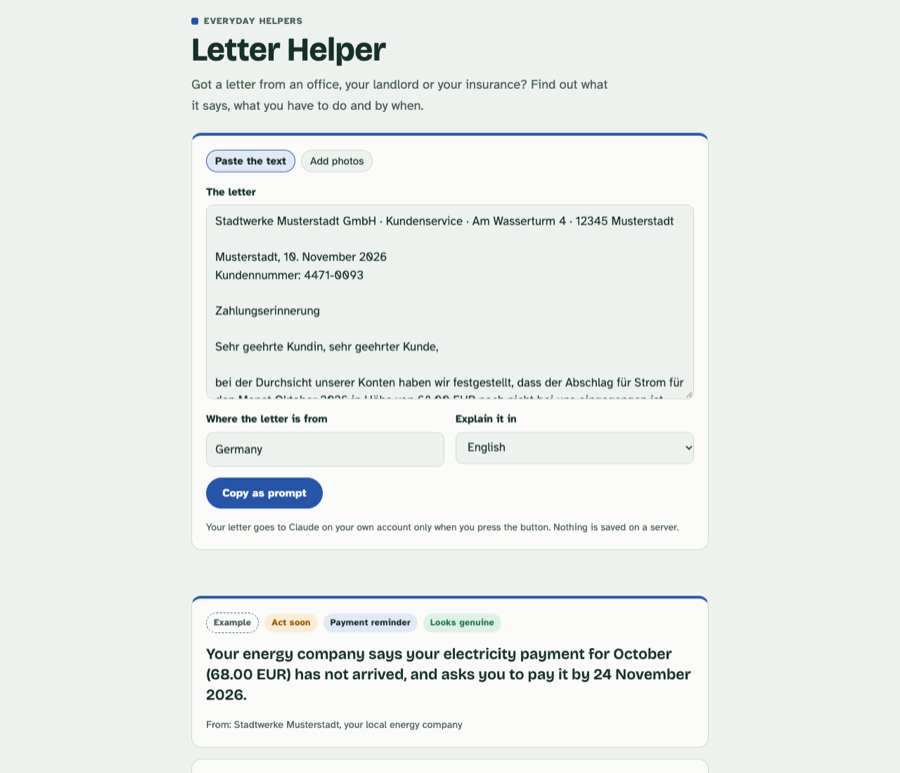
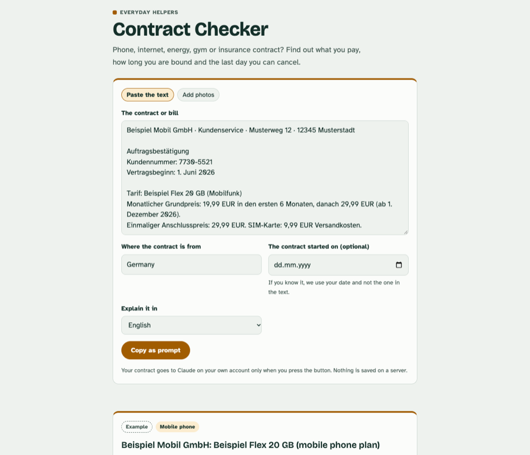
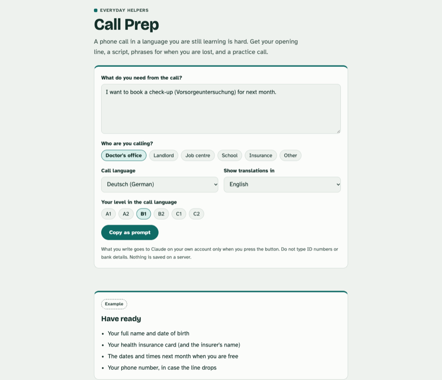
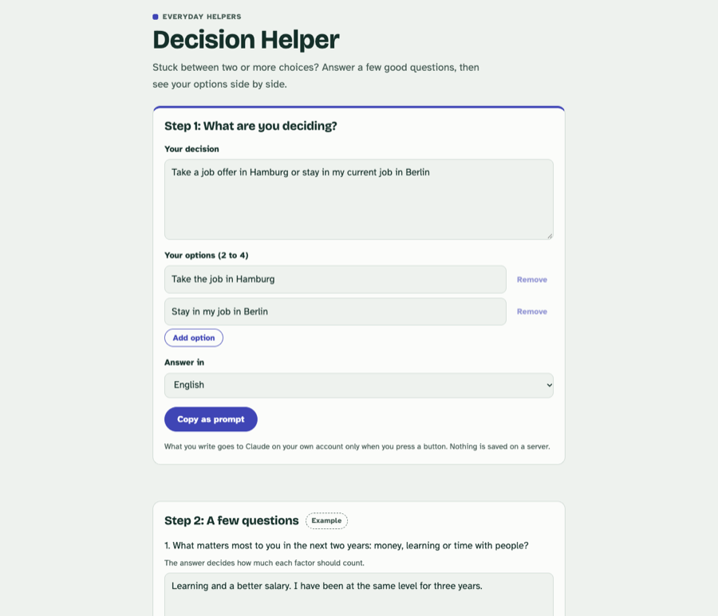
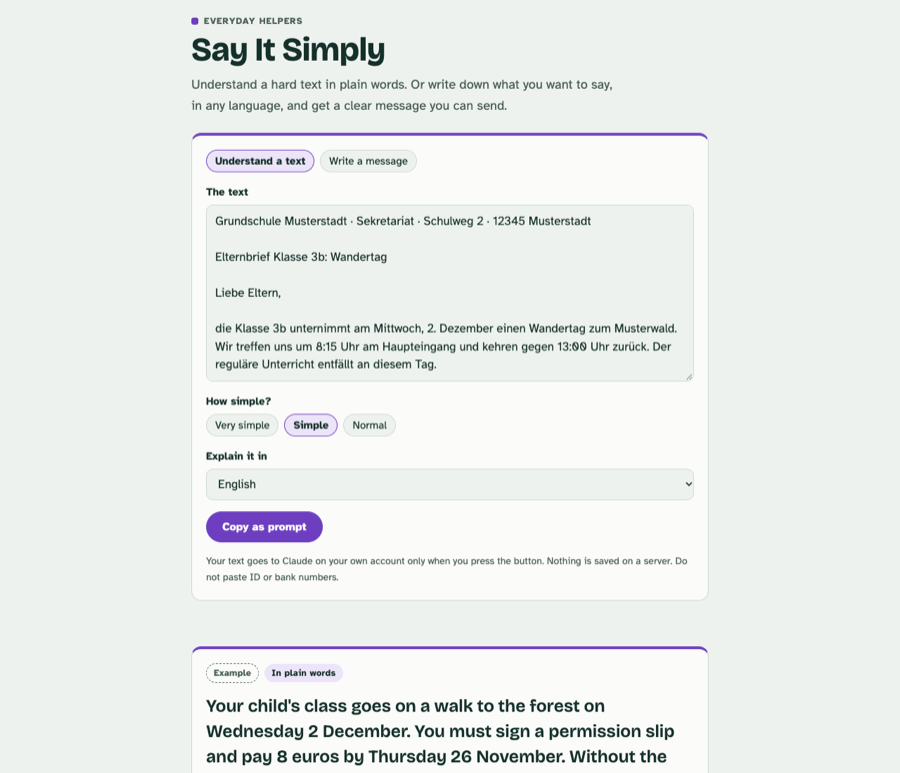
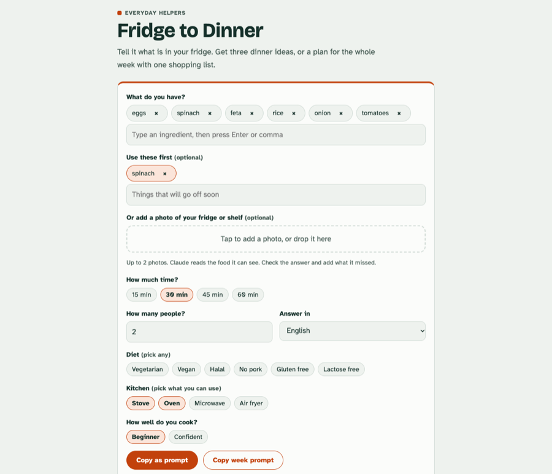
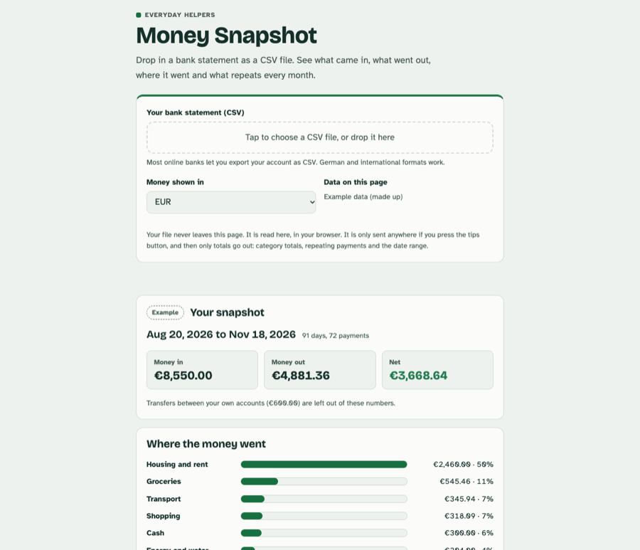

# Everyday Claude Tools

Seven small, free tools for everyday paperwork and life admin. Each is one web page. Open it, look at the filled
example, then put in your own letter, contract, fridge photo or question. Claude does the reading and explaining;
the page does the dates and the maths.

They were made for people who live in a country whose language they are still learning, but they work for anyone.
Every tool answers in 12 languages: English, German, French, Spanish, Italian, Portuguese, Turkish, Polish, Ukrainian,
Russian, Arabic and Persian.

| Tool | What it does | Open it on Claude |
| --- | --- | --- |
| **Letter Helper** | Paste or photograph an official letter. See who sent it, what it wants, the deadline (with a calendar reminder), what happens if you ignore it, warning signs of a scam, and a reply you can send. | [Open](https://claude.ai/artifact/4NSnkpZ2DPa4C8A2T23RC4) |
| **Fridge to Dinner** | Photograph your fridge or list what you have. Get three dinners that fit your time, diet and kitchen, with what you would still need to buy. Or plan a week of dinners with one shopping list. | [Open](https://claude.ai/artifact/Q8sAsbF1dKu9zhnAwh9tZq) |
| **Contract Checker** | Paste or photograph a phone, internet, energy, gym or insurance contract. See what you really pay, how long you are bound, the last day you can cancel (worked out by the page), and a cancellation letter. | [Open](https://claude.ai/artifact/W8mR84o39nNjjfsjFGuXMU) |
| **Call Prep** | Prepare a phone call in a language you are learning: what to have ready, your opening line, the call line by line, phrases for when you get stuck, and a practice call where Claude plays the other side. | [Open](https://claude.ai/artifact/5D1Ne5u8qQSGsEqcJG2fVv) |
| **Money Snapshot** | Load a bank statement export (CSV). The page adds up money in and out, groups spending, finds subscriptions and their yearly cost. Only if you ask, Claude gets the category totals and the repeating payments you leave ticked (never account numbers or single payments) and suggests three ways to save. | [Open](https://claude.ai/artifact/L7GKDpCqrobhF7PjP7wYNZ) |
| **Say It Simply** | Turn a hard text into plain words, or write what you want to say in any language and get a clear, polite message to send. | [Open](https://claude.ai/artifact/CiMY4Bog2yi1SgvQ64K9Wv) |
| **Decision Helper** | Stuck between two to four choices? Answer a few good questions, then see your options scored side by side, with weights you control. | [Open](https://claude.ai/artifact/EArZrcZmuguwKfB2251bWP) |

## How to use them

1. Open a tool's link while you are signed in to [claude.ai](https://claude.ai).
2. The page opens on a filled example, so you can see what you will get before you type anything.
3. Replace the example with your own text or photos and press the main button.
4. The first time, Claude asks whether this page may use Claude for you. Each answer uses your own Claude account
   and counts towards your normal usage. Nobody else pays for it, and nobody else sees it.
5. If the page cannot reach Claude in your view, the main button says **Copy as prompt** instead (see below).

### Without a Claude sign-in

You can also open the pages in this repository directly (download the `tools` folder and open a page in your
browser). There the tools cannot reach Claude, so the main button turns into **Copy as prompt**: it copies the exact
request the tool would have sent. Paste it into any Claude chat. For photos, attach them in the chat yourself.

## Privacy

- Nothing is stored on a server by these pages. Your text and photos go to Claude on your own account, only when you
  press the button.
- The only thing a page remembers, in your own browser, is the answer language you picked.
- Do not paste ID numbers, bank details or passwords. On photos, cover account numbers before you take the picture.

## What these tools are not

They explain and help you prepare. They are not legal, financial, medical or tax advice, and Claude can be wrong.
Dates the pages work out can be wrong when a contract or letter has special rules. Check anything important with the
sender, the provider or a professional (a lawyer, a consumer advice centre, a doctor).

## Screenshots

| | |
| --- | --- |
|  |  |
|  |  |
|  |  |
|  | |

## For developers

- `tools/<tool>.html` is one page per tool, written for the Claude artifact format (it starts at `<title>`, with no
  `<html>` wrapper). There is no build step and no framework.
- `tools/shared.css` and `tools/shared.js` are shared by all pages. `shared.js` wraps the artifact runtime
  (`claude.use("sample")`, `downloads`, `tts`), maps every error to a plain sentence, and falls back to copy-prompt
  mode when Claude is not available.
- Every tool builds its request in one pure `buildPrompt(...)` function, so the live request and the copied prompt are
  the same text. Totals, dates and cancel-by days are computed in the page, never by Claude.
- Text from Claude or the user is only ever put into the page as text (`textContent`), never as HTML.
- `docs/design.md` holds the full design: the shared rules and every tool's features.
- `scripts/check-pages.mjs` loads pages in headless Chrome at phone and desktop width, in light and dark, and reports
  horizontal overflow and script errors: `node scripts/check-pages.mjs <out-dir> tools/*.html`.

To publish your own copy as a Claude artifact, publish a tool's page together with `shared.css` and `shared.js`, and
declare the capabilities it uses: `sample` for all tools, with images for Letter Helper, Fridge to Dinner and Contract
Checker; `downloads` for Letter Helper and Contract Checker; `tts` for Call Prep.

## Licence

MIT. See [LICENSE](LICENSE).
